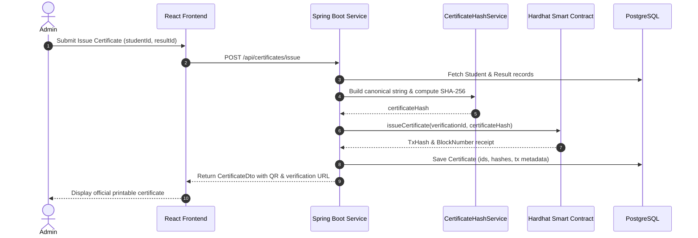
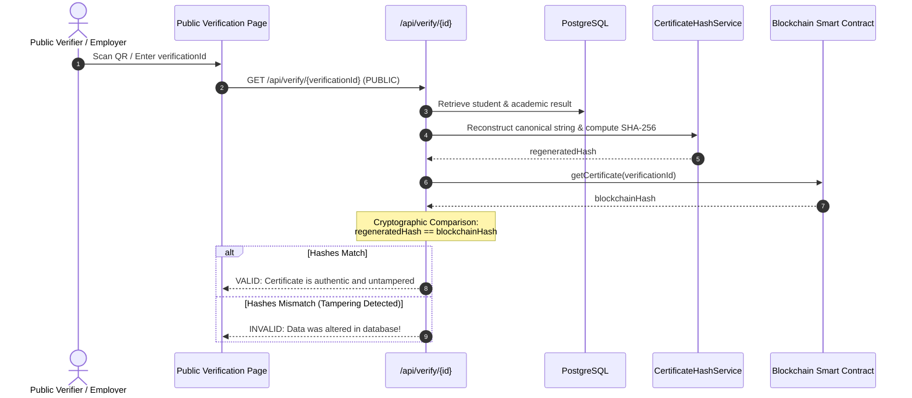

# System Architecture: Blockchain Academic Certificate Verification System

## 1. Architectural Overview

The system uses a clean, decoupled 3-tier enterprise architecture integrated with an Ethereum-compatible EVM smart contract (Hardhat node):

```
+--------------------------------------------------------------+
|                        Frontend Tier                         |
|   React.js 18 + Vite + React Router + Axios + QR Generation  |
+--------------------------------------------------------------+
                               | (HTTP / REST APIs)
                               v
+--------------------------------------------------------------+
|                        Backend Tier                          |
|   Spring Boot 3.3 (Java 21)                                  |
|   - Controller: Authentication, Students, Results, Verify    |
|   - Security: Spring Security 6, JWT, BCrypt, RBAC           |
|   - Service: Canonical Hash Service, Certificate Service     |
|   - Integration: Web3j Ethereum Client                       |
|   - Repository: Spring Data JPA                              |
+--------------------------------------------------------------+
            |                                      |
            | (SQL over TCP 5432)                  | (JSON-RPC over HTTP 8545)
            v                                      v
+------------------------+             +------------------------+
|      Database Tier     |             |    Blockchain Tier     |
|      PostgreSQL 18     |             |      Hardhat Node      |
|  (User, Student,       |             |  CertificateVerification|
|   Result, Certificate) |             |    Solidity 0.8.20     |
+------------------------+             +------------------------+
```

---

## 2. Cryptographic Canonicalization & SHA-256 Pipeline

A critical research principle implemented in this system is **deterministic canonical string formatting**. 
Because JSON object serializations have non-deterministic key ordering and whitespace differences, certificate attributes are canonicalized into a strictly defined pipe-delimited format before hashing:

```
Canonical String Format:
studentId|name|course|branch|academicYear|semester|cgpa|resultStatus

Example:
GU2027CS001|Gopal Kumar|B.Tech|CSE|2027|8|8.7|PASS
       |
       v
SHA-256 Digest (MessageDigest API, UTF-8):
66c59ce5e6570d318690938d76361eebe40b39677899eb80280ae310c1fa010d
```

---

## 3. Certificate Issuance Workflow



---

## 4. Public Cryptographic Verification Workflow


