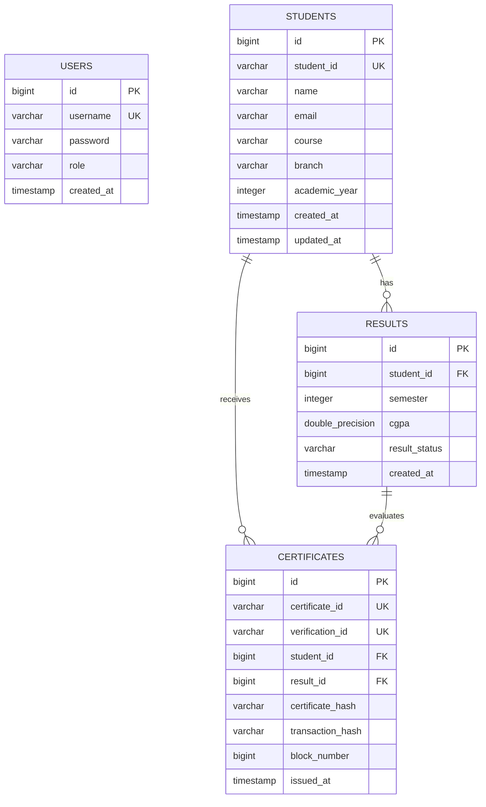

# Database Schema & Data Dictionary

Database: **PostgreSQL**  
Default Schema: `public`  
Hibernate Auto-DDL: `update`

---

## 1. Entity-Relationship Overview

---

## 2. Table Specifications

### `users`
Stores system accounts for role-based authentication.

| Column | Type | Constraints | Description |
|---|---|---|---|
| `id` | BIGSERIAL | PRIMARY KEY | Unique user ID |
| `username` | VARCHAR(100) | NOT NULL, UNIQUE | Administrative login username |
| `password` | VARCHAR(255) | NOT NULL | BCrypt one-way hashed password |
| `role` | VARCHAR(20) | NOT NULL | Role: `ADMIN` or `STUDENT` |
| `created_at` | TIMESTAMP | NOT NULL | Registration timestamp |

### `students`
Stores registered candidate information.

| Column | Type | Constraints | Description |
|---|---|---|---|
| `id` | BIGSERIAL | PRIMARY KEY | Internal primary key |
| `student_id` | VARCHAR(50) | NOT NULL, UNIQUE | Official institutional Roll Number |
| `name` | VARCHAR(150) | NOT NULL | Full name of the candidate |
| `email` | VARCHAR(150) | NOT NULL, UNIQUE | Contact email address |
| `course` | VARCHAR(100) | NOT NULL | Degree title (e.g. B.Tech) |
| `branch` | VARCHAR(100) | NOT NULL | Department / Branch (e.g. CSE) |
| `academic_year`| INTEGER | NOT NULL | Year of completion / enrollment |
| `created_at` | TIMESTAMP | NOT NULL | Record creation timestamp |
| `updated_at` | TIMESTAMP | NULL | Last modification timestamp |

### `results`
Stores semester-wise grade and academic outcome.

| Column | Type | Constraints | Description |
|---|---|---|---|
| `id` | BIGSERIAL | PRIMARY KEY | Unique result entry ID |
| `student_id` | BIGINT | NOT NULL, FK(`students.id`) | Foreign key to student |
| `semester` | INTEGER | NOT NULL | Semester number (1 to 12) |
| `cgpa` | DOUBLE PRECISION | NOT NULL (0.00 to 10.00) | Cumulative Grade Point Average |
| `result_status`| VARCHAR(20) | NOT NULL | Outcome: `PASS` or `FAIL` |
| `created_at` | TIMESTAMP | NOT NULL | Grade entry timestamp |

### `certificates`
Stores issued certificate metadata, verification mapping, and blockchain proof.

| Column | Type | Constraints | Description |
|---|---|---|---|
| `id` | BIGSERIAL | PRIMARY KEY | Unique certificate row ID |
| `certificate_id` | VARCHAR(64) | NOT NULL, UNIQUE | Institutional certificate number |
| `verification_id`| VARCHAR(64) | NOT NULL, UNIQUE | Public verification identifier |
| `student_id` | BIGINT | NOT NULL, FK(`students.id`) | Recipient student |
| `result_id` | BIGINT | NULL, FK(`results.id`) | Evaluated semester result |
| `certificate_hash`| VARCHAR(128) | NOT NULL | SHA-256 cryptographic digest |
| `transaction_hash`| VARCHAR(128) | NOT NULL | Blockchain transaction hash |
| `block_number` | BIGINT | NULL | Blockchain block height |
| `issued_at` | TIMESTAMP | NOT NULL | Certificate issuance timestamp |
